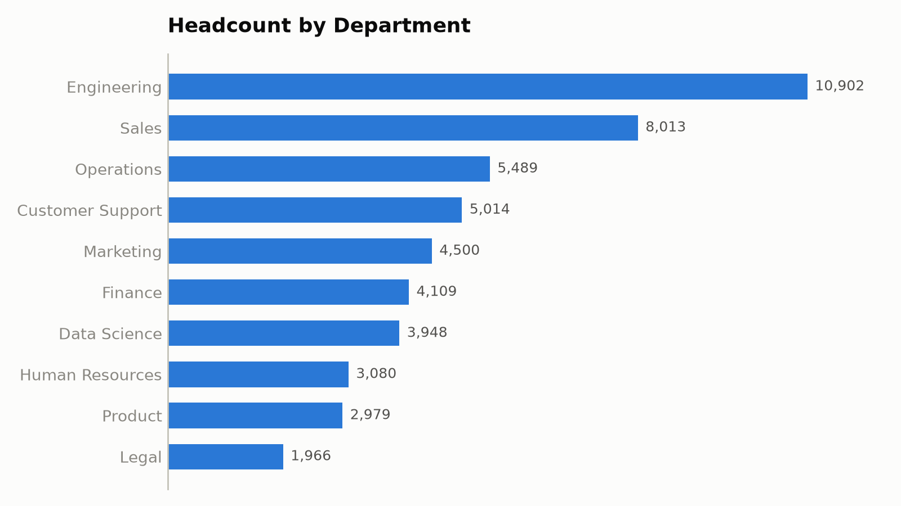
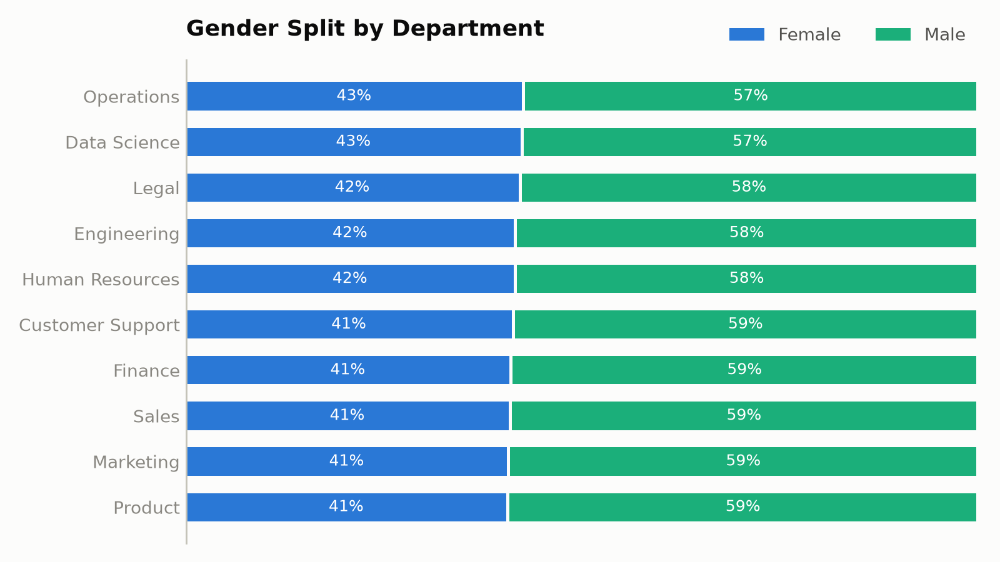
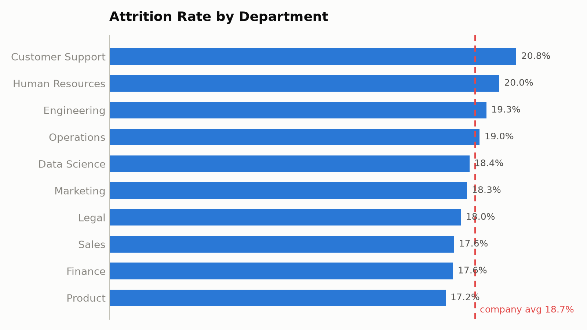
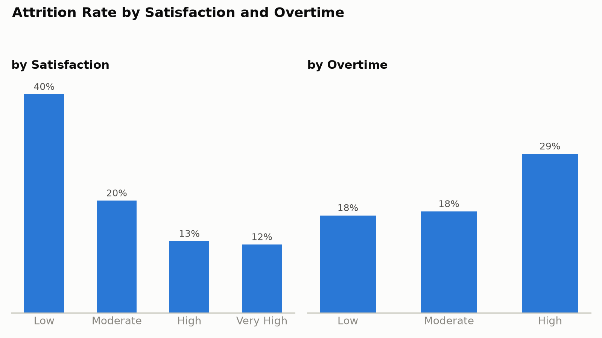
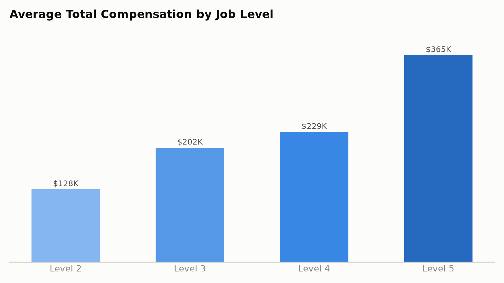
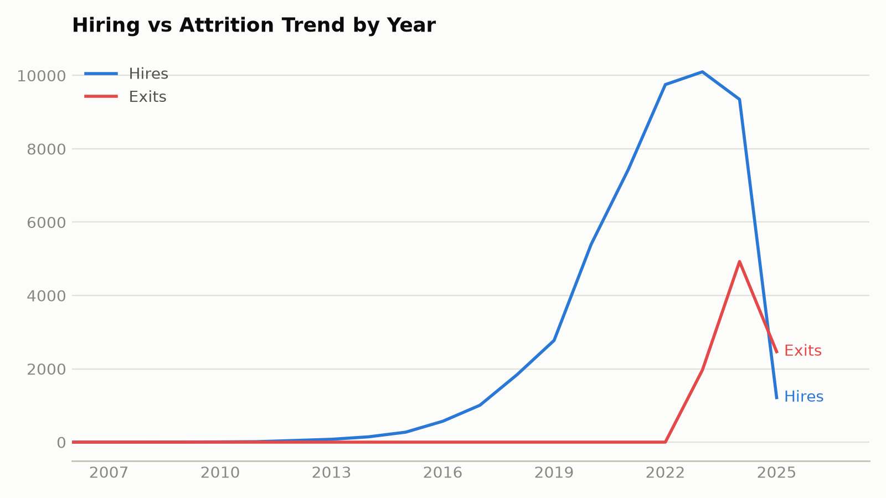

# HR Employee Analytics — Enterprise Excel Project

An end-to-end HR analytics solution built in **Microsoft Excel** on a synthetic dataset of **50,000 employee records**. It covers the full workflow a Data Analyst would deliver to HR leadership: raw data with realistic quality issues, cleaning, feature engineering, exploratory analysis, pivot-style summaries, charts, an executive dashboard, and a written business report with 30 recommendations.

---

## Project Overview

The workbook simulates a Fortune-500 HR analytics assignment. It answers questions across workforce composition, attrition, compensation, performance, promotions, diversity, and engagement, and packages the findings into an executive-ready dashboard and report.

## Business Problem

HR leadership needs to monitor workforce health, understand what drives attrition, evaluate pay and performance, and plan hiring — all from a single, interactive Excel solution rather than scattered reports.

## Dataset Description

- **50,000 employees**, 56 raw fields spanning employee info, employment, compensation, performance, attendance, engagement, and attrition.
- Values are **correlated and realistic**: salary scales with job level, education and experience; attrition is driven by satisfaction, work-life balance, overtime, pay band and promotion history.
- The raw data intentionally contains **duplicates, blank rows, missing values, inconsistent text/case, and invalid ages/salaries** for cleaning practice.

## Data Cleaning Process

Performed and documented in the workbook (see **Cleaning_Demo** and **Documentation** sheets):

- Remove Duplicates (250 duplicate records)
- `TRIM` / `CLEAN` — strip spaces and non-printing characters
- `PROPER` / `UPPER` / `LOWER` — standardise name capitalisation
- Find & Replace / `SUBSTITUTE` — unify department names (HR → Human Resources, DataScience → Data Science)
- Standardise Gender (M/male/MALE → Male; F/female → Female)
- `VALUE` + `SUBSTITUTE` — convert salary text (e.g. `"$ 95,000"`) to numbers
- Data Validation + Conditional Formatting — flag invalid ages and non-positive salaries
- Remove 60 blank rows; handle missing values (median/mode imputation)

## Excel Features Used

Excel Tables, named ranges, structured references, Data Validation, Conditional Formatting, pivot-style summary tables, native charts, and a formula-driven KPI dashboard.

## Formula Library (live in the workbook)

- **Logical:** IF, IFS, SWITCH, AND, OR, IFERROR
- **Lookup:** VLOOKUP (approx match), INDEX/MATCH
- **Aggregation:** COUNTIFS, SUMIFS, AVERAGEIFS, MAXIFS, MINIFS, COUNTA, SUMPRODUCT
- **Statistics:** AVERAGE, MEDIAN, PERCENTILE, RANK
- **Text:** TEXTJOIN, CONCAT, PROPER, TRIM, CLEAN, SUBSTITUTE, VALUE, TEXT
- **Date/Time:** YEAR, MONTH, TEXT, DATE, DATEDIF, EDATE, YEARFRAC, TODAY

## Pivot Table / Summary Coverage

Formula-driven summaries (ready to be rebuilt as native PivotTables) for: Department, Salary Band, Attrition (by age, gender, band, department), Performance, Promotion, Diversity (gender, education, work mode, office), Engagement, Overtime, Training, and Hiring/Attrition trend.

## Dashboard Overview

The **Dashboard** sheet has 10 live KPI cards (Total/Active Employees, Attrition Rate, Avg Comp, Promotion Rate, Avg Experience/Satisfaction/Performance, Departments, Locations) plus embedded charts (headcount, attrition by department, gender split, hiring vs attrition trend, salary bands). All KPIs recalculate from `Cleaned_Data`.

## Charts

15 charts in the **Charts** gallery: column, bar, line, pie, doughnut, stacked bar, area, combo (bar+line) and scatter — covering headcount, compensation, attrition, performance, diversity, engagement and hiring trends.

## Analysis Gallery

Key analysis visuals generated from `HR_Employee_Cleaned.xlsx` (all 50,000 records):

### Workforce Composition

| | |
|---|---|
|  |  |

Engineering (10,902) and Sales (8,013) are the largest departments; the gender mix is consistent across departments at roughly 41–43% female.

### Attrition

| | |
|---|---|
|  |  |

Customer Support (20.8%) and Human Resources (20.0%) sit above the company average of 18.7%. Attrition climbs steeply for low-satisfaction employees (40% vs 12% for very-high satisfaction) and for high-overtime employees (29% vs 18%).

### Compensation & Hiring Trends

| | |
|---|---|
|  |  |

Pay scales cleanly with job level ($128K at Level 2 up to $365K at Level 5). Hiring accelerated from 2016, peaked in 2023, and exits are concentrated in the most recent years.

## Key Business Insights

- Overall attrition ≈ **18.7%**, concentrated in lower-satisfaction, high-overtime and lower-band employees.
- Long-tenured employees without recent promotions are a distinct flight-risk group.
- Pay scales with level, education and experience; US/UK/Singapore offices carry a location premium.
- Pay-for-performance holds — higher ratings map to higher pay and more promotions.
- Customer Support and Operations show the weakest engagement and highest attrition.

## Recommendations

30 actionable recommendations are provided in the **Executive_Summary** sheet and **HR_Business_Report.pdf** (retention programmes, overtime caps, career ladders, pay benchmarking, predictive attrition scoring, and more).

## Project Structure

```
HR_Analytics_Master.xlsx     Main workbook (18 sheets: data, analysis, dashboard, docs)
HR_Employee_Dataset.xlsx     Full 50,000-row raw dataset (with quality issues)
HR_Employee_Cleaned.xlsx     Full 50,000-row cleaned dataset + 17 calculated columns
Data_Dictionary.xlsx         Standalone field definitions
HR_Business_Report.pdf       Full business report (findings + 30 recommendations)
Executive_Summary.pdf        One-page leadership briefing
images/                      Analysis charts embedded in this README
README.md                    This file
```

**Master workbook sheets:** Home · Raw_Data (sample) · Cleaned_Data · Lookup_Tables · Cleaning_Demo · Formula_Showcase · Dashboard · Dept_Analysis · Salary_Analysis · Attrition_Analysis · Performance_Analysis · Diversity_Analysis · Engagement_Analysis · Hiring_Trends · Charts · Executive_Summary · Data_Dictionary · Documentation

## Skills Demonstrated

Data cleaning & standardisation · feature engineering · exploratory data analysis · advanced Excel formulas · pivot-style summarisation · charting & dashboard design · business storytelling · workbook architecture & documentation.

---

## Notes on Build & Microsoft 365 Extensions

- The **17 per-row calculated columns** in `Cleaned_Data` are materialised as values for fast opening across 50,000 rows; the **Formula_Showcase** sheet demonstrates the exact same logic as live formulas on a sample, and the full formula set is documented.
- All **analysis, dashboard and KPI figures are live formulas** and recalculate automatically.
- The master's `Raw_Data` sheet holds a **2,000-row sample** of the messy data; the complete raw dataset is in `HR_Employee_Dataset.xlsx`.
- To add the remaining M365-native layers in Excel: convert `Cleaned_Data` to a Table (Ctrl+T), build **PivotTables**, add **Slicers/Timelines**, use **Power Query** (Get Data) to reshape/append/merge, and **Power Pivot + DAX** for measures. `XLOOKUP`, `FILTER`, `UNIQUE`, `SORT`, `LET` and `LAMBDA` work in Microsoft 365 and are documented in the workbook.
